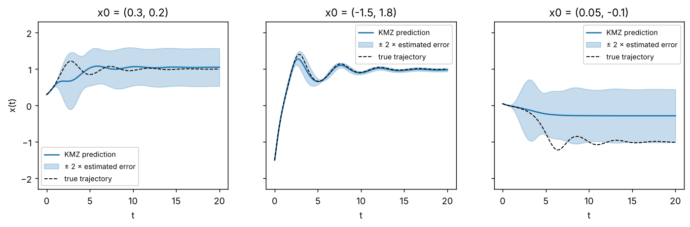
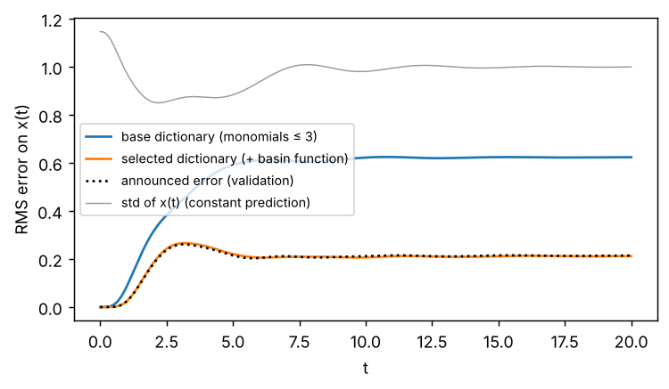
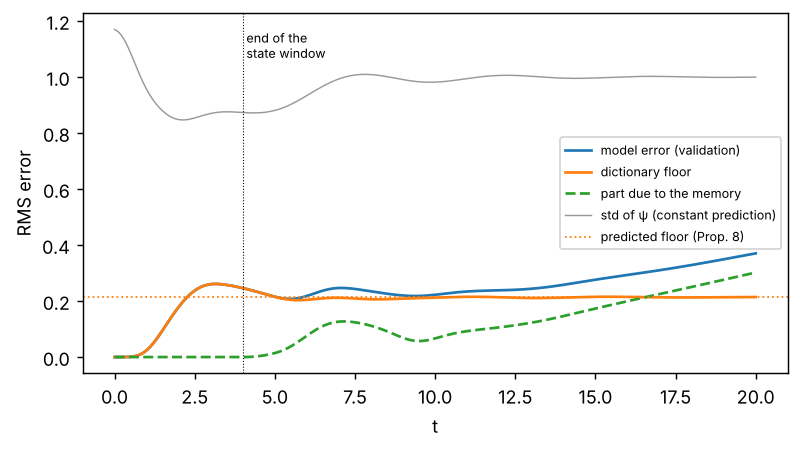
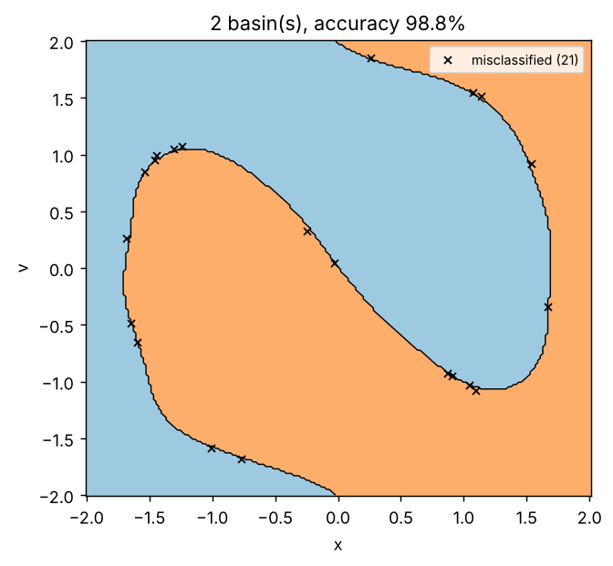

# Tutorial: predicting damped Duffing from data

The system is a damped double-well oscillator,

  ẍ = −0.5 ẋ + x − x³,

whose state is (x, v = ẋ). Every trajectory ends at the bottom of one of the two wells, x = +1 or x = −1.
The goal: from trajectories only, **predict x(t)** for a new initial state, with an error bar, then
**draw the two basins** and **analyse** the system.

The full script is [`tutorial_duffing.py`](tutorial_duffing.py) (about 2 minutes):

```bash
cd kmz
python tutorial/tutorial_duffing.py
```

The numbers below are those of this script (fixed seed).

## 1. The data

In real life, the trajectories come from measurements. Here we generate them with the equations, but the
model never sees them: it only receives an array of numbers.

```python
traj = simulate(6000, 20.0, seed=0)      # array (6000, 201, 2): trajectories × times × (x, v)
data = Data(traj, dt=0.1, observable=0, names=["x", "v"])
```

6,000 trajectories, initial states drawn uniformly in [−2, 2]², 201 times spaced by 0.1.
`observable=0`: we want to predict coordinate 0, that is x.

## 2. Fitting the model

```python
model = KMZ().fit(data)
print(model)
```

```
KMZ model:
  long-time behaviour: convergence strong; basin indicator (2 classes, centres [-1.0, 1.0])
  selected dictionary: V (monomials deg<=3), basin_sharp, monomials deg 5 (17 functions)
  memory: correlations known over the whole horizon (t ≤ 20), no extrapolation
  validation error (std of ψ: 1.17): t=0: 1.43e-14; t=10: 0.212; t=20: 0.214
  predicted long-time floor (Prop. 8): 0.213
  local error bar: 97% of the validation errors fall within ± 2 bars
```

What happened, without any tuning:

- the model saw that x(t) **converges** (very small agitation at the end of the trajectories) and that the
  limit takes **two values**, −1 and +1: there are two basins;
- it learned the **basin function** ("which well does this initial state go to?") and added it to the
  dictionary, together with the degree-5 monomials;
- the long-time error, 0.214, is exactly the one predicted by Prop. 8 (0.213): only the error on states
  close to the boundary between basins remains.

## 3. Predicting, with an error bar

```python
pred = model.predict([0.3, 0.2])
pred.plot(truth=true_trajectory)
```



- In the middle, an initial state far from the boundary: the prediction follows the true trajectory and the
  bar is narrow.
- Left and right, two states close to the boundary between basins: the model cannot know for sure which
  side they fall on, and it **says so** with a wide bar. On the right, x0 = (0.05, −0.1) is almost on the
  boundary: the prediction hesitates between the two wells (≈ −0.3) and the true trajectory (which goes to
  −1) stays inside the band.

On 2,000 test trajectories never seen:

| t | 5 | 10 | 20 |
|---|---|---|---|
| real error | 0.221 | 0.206 | 0.212 |
| announced error (validation) | 0.215 | 0.212 | 0.214 |

**97.2 %** of the real errors fall within ± 2 local error bars.



Without the basin function (`KMZ(dictionary="base")`, monomials of degree ≤ 3), the error at t = 20 is
0.624, three times larger.

## 4. When the states are only known at the beginning

A harder, more realistic scenario: the full states are only known for t ≤ 4, but x(t) up to 20
(for instance a position sensor that runs for a long time).

```python
short = Data(traj[:, :41], dt=0.1, observable=0, obs=traj[:, :, 0])
ms = KMZ().fit(short)
```

Beyond t = 4, the model must extrapolate the memory (p = 19 terms kept). The test error at t = 20 rises to
**0.375** (announced 0.370: the bar remains accurate).

## 5. Evaluating the dictionary and getting advice

```python
energy = lambda X: (0.5*X[..., 1]**2 - 0.5*X[..., 0]**2 + 0.25*X[..., 0]**4)[..., None]
ev = ms.evaluate_dictionary(extra=[("energy", energy)])
print(ev)
ev.plot("evaluation.png")
```



The evaluation splits the model error (blue) into the **dictionary floor** (orange: the best possible with
these functions) and the **memory part** (green). Over the state window (t ≤ 4), the memory part is zero.
Beyond, it grows: at t = 20, floor 0.214, memory part 0.302. Extract of the advice:

```
1. Beyond the state window (t > 4), the error comes to a large extent from the memory (memory part 0.16
   versus floor 0.213): the dictionary is not the problem. Options: extend the state window
   (fit(..., memory_window=...)) if you have the data; or, up to t = 20, predict with
   predict(x0, method='projection'), which reaches the floor without memory.
2. The basin function is kept. The remaining long-time floor (0.213) comes mostly from initial states
   misclassified near the boundary between basins ...
4. The function 'energy' barely helps (+0.0%): it is already (almost) in the dictionary, or it says
   nothing about the future of ψ.
5. The residual ε is large (0.59) while the error is small: this is normal with learned invariant
   functions; do not remove a block on this criterion alone.
```

Following advice 1: `ms.predict(x0, method="projection")` gives a test error of **0.212** at t = 20,
instead of 0.375. The energy, on the other hand, does not help: it does not say which well the trajectory
ends in (it is even in x); the basin function already says it.

## 6. The basins

```python
basins = find_basins(data)
print(basins)
basins.plot("basins.png")
```

```
Basins: 2 detected over 6000 trajectories (late agitation 0.012, separation 0.003)
  basin 0: 50.3% of the trajectories, attractor ≈ [9.999e-01 6.540e-04]
  basin 1: 49.7% of the trajectories, attractor ≈ [-9.999e-01 -8.009e-04]
  classification accuracy (validation, 1800 trajectories): 98.83%
```



Both attractors (x = ±1, v = 0) are found without knowing the equations. The map shows the two basins
wound into each other; the 21 misclassified validation trajectories (crosses) all lie on the boundary.
On the 2,000 test trajectories: **98.55 %** correctly classified. `basins.classify(x0)` gives the basin of a
new state without simulating its trajectory.

## 7. Analyse: understand rather than predict

```python
report = analyze(data, model=model, basins=basins)
print(report)
report.write("tutorial/duffing_analysis")      # analysis.md + figures
```

The full report is in [`duffing_analysis/analysis.md`](duffing_analysis/analysis.md). Its summary:

- the trajectories group into **2 final behaviours** (x → +1 or −1), separated with 98.8 % accuracy from the
  initial state alone;
- **no oscillating Koopman mode is reliable**: the eight modes with the largest weight fail the checks
  (residual along the trajectories, stability when the lag changes). The dictionary, polynomials over the
  whole square [−2, 2]², cannot represent the damped oscillation at the bottom of each well (true period
  ≈ 4.5, half-life ≈ 2.8). The tool says so instead of showing a false frequency;
- **the memory matters**: without it, the error would be multiplied by 3.3; the memory kernels decay with
  a characteristic time ≈ 2.8;
- ψ remains predictable over the whole duration (final error 0.21 for a std of 1).

For comparison, on Van der Pol, `analyze` finds the limit-cycle mode: period 6.64 (true: 6.66), no
damping, and judges it reliable.

The report describes; it does not interpret. Saying *why* there are two basins (two potential wells) or
what the memory represents physically remains your work.

## What to remember

- The model predicts **the best possible approximation within its dictionary**, not the exact trajectory.
  Near a basin boundary, it predicts an average between the two outcomes and announces it with a wide bar.
- The error bar is measured on held-out trajectories: it is reliable **where there are data** (times and
  initial states), not beyond.
- This tutorial uses data without measurement noise; the behaviour with noise has not been tested yet.
