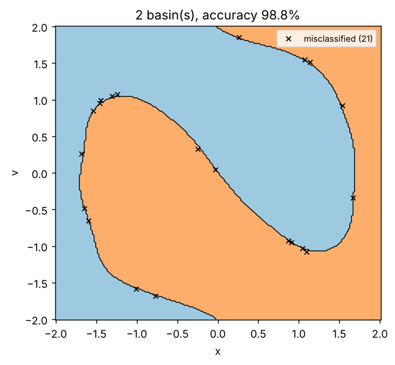
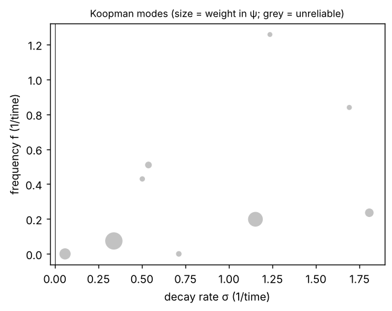
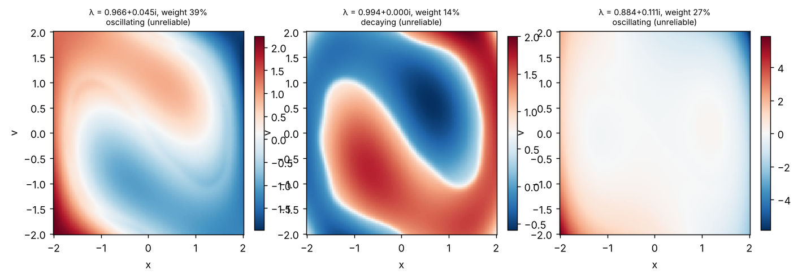
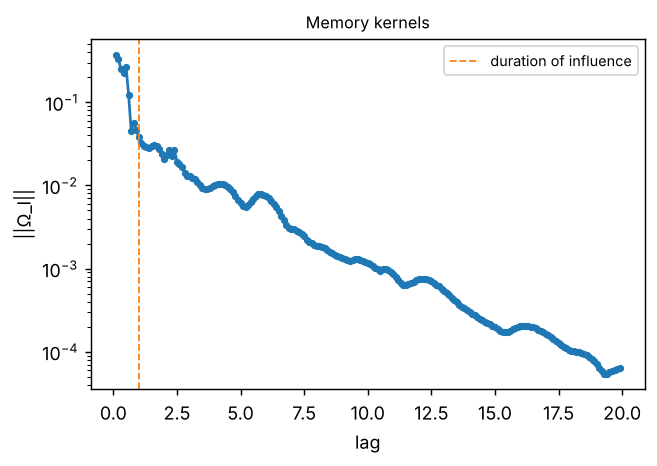
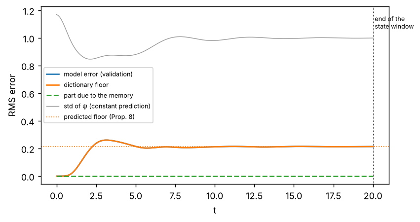

# Analysis of the system from the data

## The data

6000 trajectories, state of dimension 2, step dt = 0.1
states known over t ≤ 20, observable 'x' over t ≤ 20
effective dimension of the initial states (99 % of the variance): 2
region covered by the initial states: [-2, 2] × [-2, 2]

## The long-time behaviour

ψ: convergence strong (agitation at the end of the data 0.008)
detected invariant function: basin indicator (2 classes, centres [-1.0, 1.0])
Basins: 2 detected over 6000 trajectories (late agitation 0.012, separation 0.003)
    basin 0: 50.3% of the trajectories, attractor ≈ [9.999e-01 6.540e-04]
    basin 1: 49.7% of the trajectories, attractor ≈ [-9.999e-01 -8.009e-04]
    classification accuracy (validation, 1800 trajectories): 98.83%
    ambiguous (unconverged) trajectories excluded: 0

## The Koopman modes

Modes with the largest weight in ψ (model dictionary, one-step EDMD). A mode is 'reliable' if it
passes two checks: it satisfies φ(x(t)) ≈ λ^k φ(x0) along the validation trajectories (residual
< 0.2), and it stays the same when the computation is redone with a lag t ≈ 1 (gap < 0.1).
       weight   λ (± for a pair)       kind          half-life   period   residual (at t)   lag gap
       38.6%   +0.9656 ± 0.0451i   oscillating       2.05      13.5   0.405 (1)      0.526   unreliable
       14.3%   +0.9941              decaying          11.8         —   0.238 (1)      0.475   unreliable
       27.3%   +0.8843 ± 0.1109i   oscillating      0.602      5.04   0.230 (1)      0.141   unreliable
        7.0%   +0.8256 ± 0.1233i   oscillating      0.384      4.24   1.090 (1)      0.200   unreliable
        3.0%   +0.8995 ± 0.2983i   oscillating       1.29      1.96   0.690 (1)      0.144   unreliable
        1.0%   +0.9313              decaying         0.973         —   0.762 (1)      0.181   unreliable
        0.7%   +0.9166 ± 0.2536i   oscillating       1.38      2.33   0.808 (1)      0.057   unreliable
        0.4%   +0.7297 ± 0.4249i   oscillating       0.41      1.19   0.998 (1)      0.493   unreliable

## The memory

one-step projection residual ε = 0.592 (share of the dynamics leaving the dictionary)
||Ω_l|| for l = 1..5: [0.3702, 0.3307, 0.2484, 0.2243, 0.2668]
duration of influence of the memory (||Ω_l|| > 10 % of its maximum): t ≈ 1
mean decay of the memory: characteristic time ≈ 2.83
without memory (Markovian model), the mean error over t ≤ 20 would be multiplied by 3.31
truncation kept for extrapolation: p = 15

## The predictability

dictionary: V (monomials deg<=3), basin_sharp, monomials deg 5 (17 functions)
error at the end of the horizon (t = 20): 0.214; dictionary floor 0.214; std of ψ 1
predicted long-time floor (Prop. 8): 0.213

## Summary

- The trajectories group into 2 distinct final behaviours (basins). The learned basin function separates them with 98.8% accuracy from the initial state alone (map: basins.png); the errors concentrate near the boundaries.
- No reliable Koopman mode carries a significant part of ψ: the dictionary does not contain an eigenfunction of the dynamics (typical of chaos or of a too poor dictionary).
- The memory matters: the part of the system that the dictionary does not see keeps acting on ψ for t ≈ 1; ignoring it would multiply the error by 3.31 (over t ≤ 20).
- ψ remains predictable over the whole studied duration (final error 0.21 versus a std of 1).

## Limitations of this analysis

- 8 of the first 8 modes fail one of the two reliability checks: they are probably artefacts of the projection onto the dictionary (EDMD). Do not interpret them as frequencies or damping rates of the system. Local modes around an attractor (e.g. the damped oscillation at the bottom of a well) may be easier to see by analysing one basin at a time: analyze(data.subset(basin_indices)).
- Everything is measured in the model's dictionary: a phenomenon that its functions cannot represent is invisible here (this is the floor).
- The results hold for the region of state space covered by the data, and for the observed duration.
- Data assumed free of measurement noise: the behaviour with noise has not been tested.
- The tool describes what the data do; linking a mode, a basin or a memory time to a physical mechanism remains your work of interpretation.
